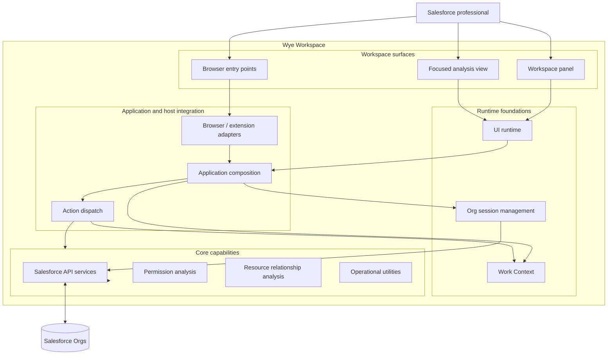
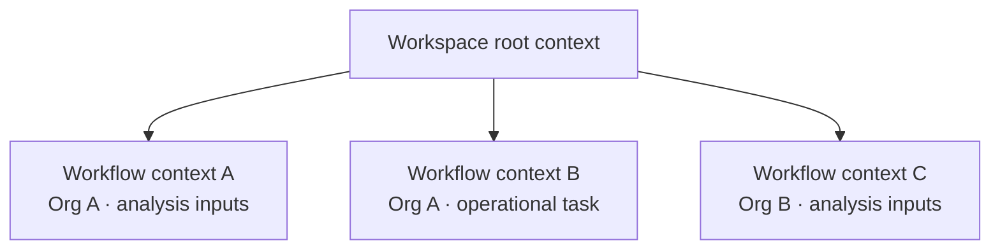
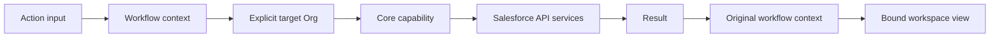

# Wye Architecture Overview

**Status:** Public architecture overview  
**Last reviewed:** 2026-11  
**Audience:** Salesforce professionals, developers, technical reviewers, and potential contributors

[中文说明](#wye-架构概览)

This document describes the architectural model and engineering boundaries behind Wye. It is intentionally a public, high-level view: it explains the responsibilities and relationships between major parts of the system without publishing private implementation details, internal decision records, or security-sensitive configuration.

The diagrams are conceptual. They communicate the current architectural direction and major runtime responsibilities; they are not exhaustive class diagrams or a guarantee that every planned capability is already shipped.

## 1. Architectural intent

Wye is designed as a **Salesforce runtime analysis workspace**, rather than a collection of unrelated utilities.

Its architecture is organized around three concerns:

1. **A multi-Org runtime** — work must be associated with the intended Salesforce Org.
2. **Context-aware execution** — actions operate on an explicit working context and preserve that context across asynchronous steps.
3. **Composable analysis capabilities** — capabilities such as Permission and Reference can be entered from different workspace surfaces without making the UI the owner of business logic.

The goal is to make investigation and operational work more coherent: a user can move from a Salesforce resource or operational task into a focused analysis flow while retaining the relevant Org and input context.

## 2. System architecture



### Responsibility boundaries

| Area | Responsibility | Boundary |
|---|---|---|
| Workspace surfaces | Present operational tools and analysis results | UI components do not own Salesforce domain rules |
| UI runtime | Coordinate UI state, context binding, and navigation | UI navigation does not determine the lifetime or ownership of business data |
| Application integration | Connect the workspace, runtime services, action dispatch, and browser host | Browser-specific APIs remain at the host boundary |
| Work Context | Associate workflow inputs and results with a stable working context | A displayed view is not itself the owner of workflow data |
| Session management | Manage authenticated Org sessions and selected Org information | Session availability is distinct from proof that every future request will succeed |
| Core capabilities | Perform Salesforce operations and domain analysis | Analysis logic is kept separate from presentation concerns |
| Salesforce services | Communicate with the target Salesforce Org | Requests must be directed to the intended Org |

## 3. Context-aware execution

A central design principle is that **the context used by an action must remain explicit**.

A context represents a unit of work: its inputs, its Org association where relevant, and the results produced by that workflow. It is not synonymous with a browser tab, panel, modal, or currently visible screen.



This model supports several important behaviors:

- Separate workflows can retain independent inputs and results, even when they target the same Org.
- A workflow can be opened from different workspace surfaces without tying its data to one particular UI component.
- Creating a new workflow context does not, by itself, force the UI to navigate to it.
- An asynchronous action keeps its original context association. If the user navigates elsewhere while it runs, its result still belongs to the workflow that started it.
- The target Org is explicit for the operation; it is not inferred from whichever Org happens to be selected when an asynchronous response returns.

### Example: an action that outlives a UI navigation

```mermaid
sequenceDiagram
    actor User
    participant UI as Workspace UI
    participant Core as Wye Core
    participant SF as Salesforce Org A
    User->>UI: Start analysis in context A
    UI->>Core: Dispatch action with context A and Org A
    Core->>SF: Execute Salesforce requests
    User->>UI: Navigate to context B
    SF-->>Core: Return analysis data
    Core->>Core: Associate result with context A
    Note over UI,Core: The UI stays on context B; no forced navigation
```

This separation avoids a common class of multi-Org and asynchronous UI errors: a late response being written into, or displayed as if it belonged to, a different workflow.

## 4. Multi-Org request path

Multi-Org support is a runtime concern, not merely a selector in the interface.

At a high level, an operation follows this path:

1. The user initiates an action from a workspace surface.
2. The action is associated with a workflow context and a target Org.
3. The relevant Core capability performs the requested operation through Salesforce services.
4. The result is associated with the originating workflow context.
5. The UI renders the result for whichever context the user chooses to view.



A selected or connected Org indicates that a session is available to attempt work. It should not be described as a guarantee that a token is valid indefinitely or that every Salesforce request will succeed. Request and refresh failures must remain observable and actionable.

## 5. Capability model

Wye groups functionality around Salesforce work rather than around isolated screens.

- **Session and Org operations** provide the runtime foundation for working across multiple Orgs.
- **Permission analysis** aims to explain access at object, field, and record levels, including the sources that contribute to effective access.
- **Reference analysis** aims to help users explore relationships between Salesforce resources and metadata.
- **Operational utilities** support selected data and developer workflows.

Permission and Reference are evolving capabilities. The public roadmap remains the source of truth for delivery status. A capability name in this architecture diagram should not be interpreted as a claim that every analysis scenario is complete.

## 6. Engineering principles

### Explicit context over ambient state

An action should receive the context and target Org it needs. It should not silently depend on a mutable global selection during execution.

### Domain logic independent of presentation

Salesforce rules and analysis belong in Core capabilities and services, not in React components or browser-specific UI code.

### Browser integration at the boundary

Browser extension APIs are host integration concerns. Core analysis should not need to know how a browser tab, panel, or extension message is implemented.

### Evidence-aware analysis

Analysis should distinguish confirmed facts, observed configuration, inferred relationships, and unresolved information. Missing data should not silently become a negative conclusion.

### Incremental architecture

Abstractions should correspond to real responsibilities and stable boundaries. The project avoids adding layers solely for symmetry or theoretical completeness.

## 7. Security and trust boundaries

Wye interacts with Salesforce using the user's authenticated Org sessions. The connected Org and the permissions of the authenticated Salesforce user constrain what operations can succeed.

The architecture distinguishes:

- **Workspace context** — which workflow owns the inputs and results.
- **Org identity** — which Salesforce Org an operation targets.
- **Authentication/session state** — whether an authenticated session is available and whether requests or refresh operations succeed.
- **Salesforce authorization** — what the authenticated user is permitted to access in the target Org.

These concepts are related, but they are not interchangeable. In particular, selecting an Org does not grant Salesforce permissions, and a successful metadata lookup does not establish record-level access.

For data handling and privacy commitments, see the project's [Privacy Policy](./Privacy%20Policy.md). This architecture overview does not replace that policy.

## 8. Current scope and evolution

This overview describes architectural foundations and intended boundaries, not a promise that all future capabilities are available today.

- Current workspace and utility availability is described in the README.
- Planned capability scope and delivery stages are described in [ROADMAP.md](./ROADMAP.md).
- Publicly tracked work is listed in [BACKLOG.md](./BACKLOG.md).

As the implementation evolves, this document should be updated when a material architectural boundary changes. Claims about shipped behavior should be checked against the corresponding release and its verification evidence.

---

# Wye 架构概览

本文面向社区、开发者和技术评估者，介绍 Wye 的主要架构职责与运行边界。它是经过筛选的公开技术说明，不包含私有仓库中的内部决策记录、完整实现细节或安全敏感配置。

图示表达的是系统层面的职责关系，不是完整类图，也不代表所有规划能力已经发布。

## 1. 架构目标

Wye 的定位是 **Salesforce 运行时分析工作空间**，而不是互不相关的工具集合。

架构围绕三个问题组织：

1. **多 Org 运行基础**：每项工作都应明确关联目标 Salesforce Org。
2. **上下文驱动执行**：Action 在明确的工作上下文中执行，异步过程也保持原有上下文归属。
3. **可组合的分析能力**：Permission、Reference 等能力可以从不同工作空间入口进入，而不让 UI 承担领域逻辑。

目标是让 Salesforce 调查、操作与分析形成连贯流程：用户可以从资源或操作任务进入专门的分析链路，并保留相关 Org 与输入信息。

## 2. 系统架构

上方系统图展示了工作空间界面、Application/宿主集成、运行时基础能力和 Core 能力之间的关系。

| 模块 | 职责 | 边界 |
|---|---|---|
| Workspace surfaces | 呈现操作工具和分析结果 | UI 组件不拥有 Salesforce 领域规则 |
| UI runtime | 协调界面状态、上下文绑定和导航 | UI 导航不决定业务数据的所有权和生命周期 |
| Application integration | 连接工作空间、运行时服务、Action 分发和浏览器宿主 | 浏览器特定 API 留在宿主边界 |
| Work Context | 将工作流输入与结果关联到稳定上下文 | 可见界面不是业务数据的所有者 |
| Session management | 管理已认证 Org Session 与选中 Org 信息 | Session 可用不等于未来每个请求必然成功 |
| Core capabilities | 执行 Salesforce 操作和领域分析 | 分析逻辑与呈现逻辑分离 |
| Salesforce services | 与目标 Salesforce Org 通信 | 请求必须指向明确的目标 Org |

## 3. 上下文驱动执行

核心原则是：**Action 使用的上下文必须明确，并在执行期间保持稳定**。

Context 表示一个工作单元，包括其输入、必要时关联的 Org，以及该工作流产生的结果。它不等同于浏览器 Tab、Panel、Modal 或当前可见页面。

该模型意味着：

- 不同工作流可以独立保存输入与结果，即使它们面向同一个 Org。
- 工作流可以从不同界面入口访问，不依赖某个 UI 组件的生命周期。
- 创建新的工作上下文，不会自动强制 UI 跳转。
- 异步 Action 保持启动时的上下文归属。用户执行期间切换界面，返回结果仍属于原工作流。
- 目标 Org 在操作开始时明确确定，不会在异步响应返回时重新读取当前选中 Org。

这避免了多 Org 与异步交互中一类常见错误：迟到的响应被写入另一个工作流，或被误认为属于另一个 Org。

## 4. 多 Org 请求路径

多 Org 是运行时能力，而不仅仅是界面中的 Org 选择器。

一次操作的高层路径是：

1. 用户从工作空间入口发起 Action。
2. Action 绑定工作上下文和目标 Org。
3. Core Capability 通过 Salesforce Services 执行操作。
4. 结果写回发起操作时绑定的工作上下文。
5. 用户可以在工作空间中选择查看相应上下文。

选中或已连接的 Org 表示存在可用于尝试操作的 Session，不应被描述为 Token 永远有效，也不保证所有 Salesforce 请求都会成功。请求失败和刷新失败必须能够被识别并反馈。

## 5. 能力模型

Wye 围绕 Salesforce 工作组织能力，而不是围绕孤立页面组织功能：

- **Session 与 Org 操作**：提供多 Org 工作的运行基础。
- **Permission 分析**：目标是解释 Object、Field、Record 层面的访问，以及影响有效访问的授权来源。
- **Reference 分析**：目标是帮助用户探索 Salesforce 资源与 Metadata 之间的关系。
- **Operational Utilities**：支持选定的数据与开发工作流。

Permission 和 Reference 仍在演进，交付状态以公开 Roadmap 为准。架构图中出现某项能力名称，不代表所有分析场景都已完成。

## 6. 工程原则

- **显式上下文优先于隐式全局状态**：Action 应获得明确的 Context 和目标 Org，不应在执行过程中依赖可变的全局选择。
- **领域逻辑与呈现分离**：Salesforce 规则和分析属于 Core，不属于 React 组件或浏览器 UI 代码。
- **浏览器集成位于边界**：浏览器扩展 API 属于宿主集成，Core 分析不应依赖 Tab、Panel 或扩展消息的具体实现。
- **尊重证据**：分析应区分已确认事实、观察到的配置、推断关系和未知信息。数据缺失不应被静默解释为否定结论。
- **渐进式架构**：抽象应对应真实职责和稳定边界，不为理论上的层次对称而增加复杂度。

## 7. 安全与信任边界

Wye 使用用户已认证的 Salesforce Org Session 与 Salesforce 交互。具体操作能否成功，受目标 Org 和当前 Salesforce 用户权限约束。

架构上需要区分：

- **工作上下文**：哪个工作流拥有输入和结果。
- **Org 身份**：操作目标是哪一个 Salesforce Org。
- **认证与 Session 状态**：是否存在可用 Session，以及请求或刷新是否成功。
- **Salesforce 授权**：当前用户在目标 Org 中实际允许访问什么。

这些概念彼此相关，但不能互相替代。选择 Org 不会自动获得 Salesforce 权限；成功读取 Metadata 也不能证明用户拥有记录级访问权限。

数据处理与隐私承诺请参阅项目的 [Privacy Policy](./Privacy%20Policy.md)。本文不替代隐私政策。

## 8. 当前范围与演进

本文描述架构基础和预期边界，不承诺所有未来能力当前均已可用。

- 当前工作空间和工具能力以 README 为准。
- 能力规划和阶段状态以 [ROADMAP.md](./ROADMAP.md) 为准。
- 公开跟踪的工作项见 [BACKLOG.md](./BACKLOG.md)。

当实现中的重要架构边界发生变化时，应同步更新本文。关于已发布行为的描述，应以对应版本及其验证证据为准。
