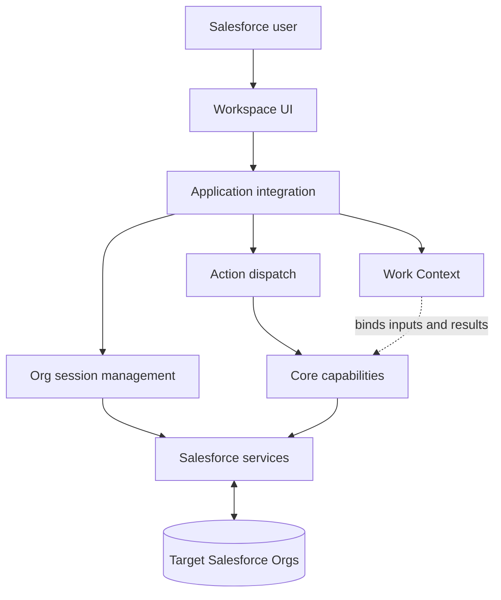

# Wye Architecture

**Wye is a Salesforce runtime analysis workspace.** It brings multi-Org work, context-aware execution, and composable analysis capabilities into one workspace.

This page is a high-level guide to the system's architectural boundaries. It intentionally excludes private implementation details and internal decision records. The diagram is conceptual, not an exhaustive implementation map.

## Architecture at a glance

- **Workspace UI** presents tools and analysis views; it does not own domain rules.
- **Application integration** connects the UI, runtime services, action dispatch, and browser host.
- **Work Context** associates a unit of work with its inputs, target Org where relevant, and results.
- **Core capabilities** implement Salesforce operations and domain analysis independently of presentation.
- **Salesforce services and session management** route requests to the intended Org and handle authenticated communication.

## Three architectural ideas

### 1. Multi-Org is a runtime concern

An Org selector alone does not provide reliable multi-Org behavior. Each operation needs an explicit target Org and an authenticated session for that Org. The target must remain associated with the operation for its full lifecycle; it must not be inferred again from whichever Org is selected when an asynchronous response returns.

A connected session makes a request possible, not guaranteed. Tokens can expire, requests can fail, and Salesforce authorization remains governed by the authenticated user's permissions in the target Org.

### 2. Context-aware execution

A Work Context represents a workflow, not a screen, tab, or panel. It keeps the inputs and results of an operation associated with the work that initiated it.

This matters when users navigate while an action is still running: the result belongs to its original context, even if another context is now visible. UI navigation should not silently reassign in-flight work or force the user back to the originating view.

### 3. Composable analysis

Analysis capabilities should be reusable from different workspace entry points without moving domain logic into UI components. The workspace coordinates interaction; Core capabilities perform the work through shared Salesforce services.

Permission and Reference are important analysis directions in Wye's evolution. Their presence in the architecture does not imply that every scenario is already complete. See the public [roadmap](./ROADMAP.md) for delivery status.

## Engineering boundaries

| Concern | Owns | Does not own |
|---|---|---|
| Workspace UI | Presentation, navigation, view state | Salesforce domain rules |
| Application integration | Composition and dispatch | Capability-specific analysis |
| Work Context | Workflow inputs and result association | UI navigation state |
| Core capabilities | Operations and analysis logic | Browser-specific behavior |
| Salesforce services | Org-directed API communication | UI presentation |

The guiding principles are straightforward:

- Prefer explicit context and Org identity over mutable ambient state.
- Keep domain logic independent of React components and browser APIs.
- Treat missing or incomplete data as unknown, not as proof of absence.
- Add abstractions when they represent real responsibilities, not for symmetry alone.

## Trust and scope

Wye operates through the user's authenticated Salesforce sessions. Four things must remain distinct: workflow context, target Org identity, authentication/session state, and Salesforce authorization. Selecting an Org does not grant permissions; successfully reading metadata does not prove record-level access.

This overview describes architectural foundations and boundaries, not a guarantee that every planned capability is shipped. Check the [README](./README.md) for the current project description, the [roadmap](./ROADMAP.md) for planned capability status, and the [Privacy Policy](./Privacy%20Policy.md) for data-handling commitments.

---

# Wye 架构说明

**Wye 是一个 Salesforce 运行时分析工作空间。** 它将多 Org 工作、上下文驱动执行和可组合的分析能力整合到同一个工作空间中。

本文只介绍系统的高层架构边界，不包含私有实现细节和内部决策记录。架构图用于表达职责关系，并非完整实现图。

## 架构概览

上图展示了 Workspace UI、Application integration、Work Context、Core capabilities 与 Salesforce services 的主要关系：

- **Workspace UI** 负责呈现工具和分析视图，不承载领域规则。
- **Application integration** 连接 UI、运行时服务、Action 分发和浏览器宿主。
- **Work Context** 将一项工作的输入、目标 Org（如适用）和结果关联起来。
- **Core capabilities** 独立于界面实现 Salesforce 操作与领域分析。
- **Salesforce services 与 session management** 负责面向指定 Org 的认证通信。

## 三个架构要点

### 1. 多 Org 是运行时能力

仅有 Org 选择器并不足以构成可靠的多 Org 能力。每项操作都需要明确的目标 Org 和对应的认证 Session。操作执行期间，目标 Org 必须保持稳定，不能在异步响应返回时重新依赖当前界面选中的 Org。

已连接的 Session 只意味着可以尝试请求，并不保证请求一定成功。Token 可能过期，请求可能失败，而 Salesforce 授权始终由目标 Org 中当前认证用户的实际权限决定。

### 2. 上下文驱动执行

Work Context 表示一个工作流，而不是某个 Screen、Tab 或 Panel。它负责关联工作流的输入和执行结果。

当用户在 Action 执行期间切换界面时，返回结果仍归属于最初发起工作的 Context。界面导航不应悄悄改变正在执行的工作归属，也不应强制用户返回原界面。

### 3. 可组合的分析能力

分析能力应能从不同工作空间入口复用，而不把领域逻辑放进 UI 组件。Workspace 协调交互，Core capabilities 通过共享的 Salesforce services 完成实际工作。

Permission 和 Reference 是 Wye 持续演进的重要分析方向。它们出现在架构中，并不意味着所有场景都已完成。具体交付状态以公开 [Roadmap](./ROADMAP.md) 为准。

## 工程边界

| 范围 | 负责 | 不负责 |
|---|---|---|
| Workspace UI | 呈现、导航、视图状态 | Salesforce 领域规则 |
| Application integration | 组合与分发 | 具体分析逻辑 |
| Work Context | 工作流输入与结果归属 | UI 导航状态 |
| Core capabilities | 操作与分析逻辑 | 浏览器特定行为 |
| Salesforce services | 面向指定 Org 的 API 通信 | UI 呈现 |

核心工程原则：

- 使用显式 Context 和 Org 身份，避免依赖可变的隐式全局状态。
- 领域逻辑与 React 组件、浏览器 API 解耦。
- 缺失或不完整的数据应视为未知，而不是直接视为不存在。
- 抽象应对应真实职责，而不是为了层次对称而增加复杂度。

## 信任边界与范围

Wye 通过用户已认证的 Salesforce Session 工作。工作上下文、目标 Org 身份、认证与 Session 状态、Salesforce 授权是四个不同概念。选择 Org 不会自动获得权限；成功读取 Metadata 也不能证明拥有记录级访问权限。

本文描述的是架构基础与边界，不保证所有规划能力都已发布。当前项目介绍见 [README](./README.md)，能力规划见 [Roadmap](./ROADMAP.md)，数据处理承诺见 [Privacy Policy](./Privacy%20Policy.md)。
