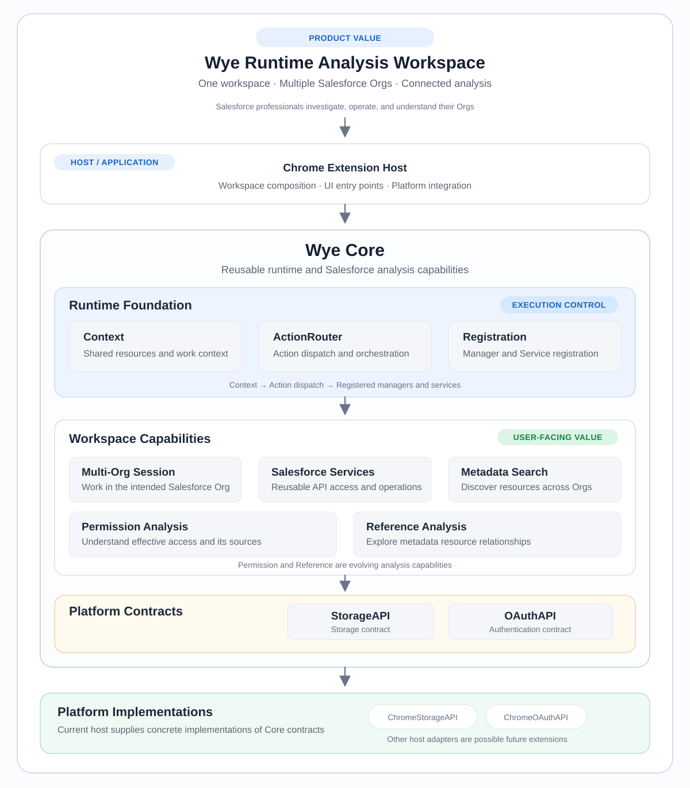

# Wye Architecture

**One workspace. Multiple Salesforce Orgs. Connected analysis.**

Wye helps Salesforce professionals investigate and operate across Orgs, understand access, and explore metadata relationships — without treating every task as a disconnected utility.

The architecture below shows how the workspace is assembled and where its extensibility comes from. It is a public, high-level view; it does not expose private implementation details.

## How Wye fits together

### Read the diagram in three steps

1. **What users get:** one workspace for multi-Org operations, metadata discovery, and analysis.
2. **How it works:** the runtime associates actions with context and routes them to reusable capabilities and Salesforce services.
3. **Why it can evolve:** Core defines platform contracts; the host supplies implementations such as Chrome storage and OAuth adapters.

## The architectural ideas behind it

### Multi-Org is part of execution, not just the interface

Each operation needs an explicit target Org and the corresponding authenticated session. The target must remain associated with the operation throughout its execution. A connected session makes a request possible, not guaranteed; Salesforce authorization is still determined by the authenticated user's permissions in that Org.

### Context keeps work attached to its origin

A Context is not a screen, tab, or panel. It provides shared resources and a stable association for work. When a user navigates elsewhere while an action is running, the result should remain associated with the context that initiated it — not whichever view happens to be visible when the response returns.

### Capabilities are reusable building blocks

The workspace provides entry points; Core capabilities perform the work. This keeps Salesforce operations and analysis from being embedded in individual UI components. The same capability model can support different user workflows as the product evolves.

## Capability status

Wye's workspace foundation includes multi-Org session operations, Salesforce services, metadata search, and selected developer utilities. Permission and Reference are the two central analysis directions, and continue to evolve. Their full scope and delivery status are tracked in the public [roadmap](./ROADMAP.md); their appearance in the diagram is not a claim that every planned scenario has shipped.

## Platform boundary

Core defines contracts for platform-dependent resources such as storage and OAuth. The current extension host supplies Chrome-specific implementations. Other hosts could provide their own adapters in the future; this is an architectural extension point, not a claim that Web, Node.js, or server deployments are currently supported products.

## Trust boundaries

Four concepts must remain distinct:

- **Context:** which workflow owns the inputs and results.
- **Org identity:** which Salesforce Org an operation targets.
- **Authentication and session state:** whether a usable authenticated session is available and whether requests succeed.
- **Salesforce authorization:** what the authenticated user is allowed to access in that Org.

Selecting an Org does not grant permissions, and successfully reading metadata does not prove record-level access. Wye's data-handling commitments are described in the [Privacy Policy](./Privacy%20Policy.md).

---

# Wye 架构说明

**一个工作空间。多个 Salesforce Org。连贯的分析能力。**

Wye 帮助 Salesforce 专业人员跨 Org 开展调查与操作、理解访问权限、探索 Metadata 关系，而不是把每项工作变成彼此割裂的工具。

下面的架构图展示工作空间如何组合，以及系统从哪里获得扩展能力。本文是经过筛选的公开高层说明，不包含私有实现细节。

## Wye 如何组合

架构图可以分三层理解：

1. **用户获得什么：** 在一个工作空间中完成多 Org 操作、Metadata 搜索和分析。
2. **系统如何工作：** Runtime 将 Action 与上下文关联，再分发给可复用的 Capability 和 Salesforce Services。
3. **为什么能够演进：** Core 定义平台契约，Host 提供具体实现，例如 Chrome Storage 和 OAuth Adapter。

## 背后的架构思想

### 多 Org 属于执行过程，而不只是界面功能

每项操作都需要明确的目标 Org 和对应的认证 Session。操作执行期间，目标 Org 必须保持稳定。Session 可用只意味着可以尝试请求，并不保证请求一定成功；最终访问能力仍由目标 Org 中当前认证用户的 Salesforce 权限决定。

### Context 让工作始终归属于发起它的地方

Context 不是 Screen、Tab 或 Panel。它提供共享资源，并稳定关联一项工作的输入与结果。当用户在 Action 执行期间切换界面时，结果仍应归属于最初发起工作的 Context，而不是响应返回时恰好可见的界面。

### Capability 是可复用的能力单元

Workspace 提供操作入口，Core Capability 负责实际工作。这样可以避免把 Salesforce 操作和分析逻辑嵌入某个 UI 组件。随着产品演进，同一套能力可以服务于不同工作流。

## 能力状态

当前工作空间基础包括多 Org Session 操作、Salesforce Services、Metadata Search 和部分开发辅助工具。Permission 与 Reference 是两大核心分析方向，仍在持续演进。具体范围和交付状态以公开 [Roadmap](./ROADMAP.md) 为准；它们出现在图中，不代表所有规划场景都已交付。

## 平台边界

Core 为 Storage、OAuth 等平台相关资源定义契约，当前 Extension Host 提供 Chrome 平台实现。未来其他 Host 可以提供自己的 Adapter。这是架构上的扩展点，不代表 Web、Node.js 或 Server 版本已经作为产品得到支持。

## 信任边界

以下四个概念必须区分：

- **Context：** 哪个工作流拥有输入与结果。
- **Org 身份：** 操作目标是哪一个 Salesforce Org。
- **认证与 Session 状态：** 是否存在可用的认证 Session，以及请求是否成功。
- **Salesforce 授权：** 当前用户在该 Org 中实际允许访问什么。

选择 Org 不会自动获得权限；成功读取 Metadata 也不能证明拥有记录级访问权限。Wye 的数据处理承诺见 [Privacy Policy](./Privacy%20Policy.md)。
